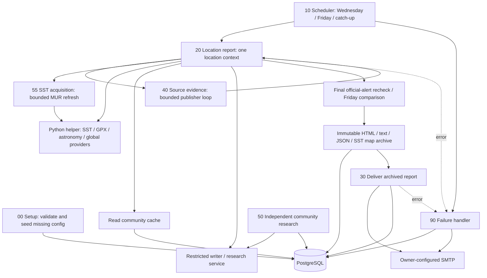

# Architecture

## Workflow graph

## Workflows

| Export / stable ID | Responsibilities |
|---|---|
| `00-setup.json` / `fishing_setup_v1` | Validates schema and seeds configuration only if `main` is absent; never replaces installed settings |
| `10-weekly-scheduler.json` / `fishing_scheduler_v1` | Weekly/Friday/manual inputs, catch-up boundaries, SMTP reconciliation, per-location loop and partial-run notices |
| `20-location-report.json` / `fishing_location_v1` | Atomic run claim, collectors, source/history/cache merge, deterministic report, optional writer/one repair, final alerts, Friday decision comparison, immutable archive and delivery reference |
| `30-deliver-report.json` / `fishing_delivery_v1` | Loads immutable archive, resolves test/subscriber recipients, claims each recipient once, records accepted/failed/unknown SMTP outcomes; attaches archived SST bytes |
| `40-source-evidence.json` / `fishing_source_v1` | Robots policy, delays, discovery, bounded extraction, original trip/publication dates, geographic/method filters and deduplication |
| `50-community-research.json` / `fishing_research_v1` | Separate bounded job/lease/cache; no report or delivery child; report generation reads its retained cache |
| `55-ocean-acquisition.json` / `fishing_ocean_acquisition_v1` | Loads enabled configured locations; scheduled, manual or location-child refresh; helper performs acquisition and map rendering |
| `90-failure-handler.json` / `fishing_failure_v1` | Records diagnostic, releases affected running claims and optionally sends one operator notice |

The builder embeds shared JavaScript into Code nodes so n8n imports are standalone. Edit `src/code-nodes/*.js` and `scripts/build-workflows.js`, then regenerate exports. Node IDs are deterministic. Public builds use the US example; custom builds go under ignored `artifacts/private/` and must never be committed.

## Services and trust boundaries

Compose runs PostgreSQL 17, n8n 2.41.6, matching external runners, a Python 3.13 helper and a Node 22 writer. PostgreSQL has separate `n8n_app` and `fishing_app` databases/users. Only the editor port is published, on loopback by default. PostgreSQL/runners use the internal network; collectors and writer also have outbound access. Helper/writer run without root, have read-only root filesystems and writable named volumes for SST cache or writer sign-in.

The helper accepts bounded requests on port 8080: `/astronomy`, `/extract`, `/robots`, `/news-rss`, `/research-fetch`, `/global-collect`, `/global-alerts`, `/ocean-acquire`, and `/ocean-features/<id>`. Its provider keys come from the deployment environment and never enter workflow JSON, report packets or archives. Publisher hosts derive from the local configuration. GPX files are mounted read-only under `/data/gpx`; generated maps/cache contain waypoint information and are private data too.

The optional writer on 8081 receives a bounded fact/evidence packet, not credentials or subscriber addresses. The result must satisfy the JSON schema and factual/citation checks. Writer failure or invalid output retains the deterministic factual report. Research yields to report writing and cannot publish email. Model access and subscription availability depend on the owner's account.

## Durable state

Migrations run in order, 001–006. They create configuration/subscribers, scheduler and location leases, immutable reports/evidence, writer-call reservations, recipient delivery claims, operational events, durable Friday evaluations, and independent community research jobs/observations/cache. SQL functions own transactional claims and edition allocation.

The run identity includes namespace (`test`/`production`), location, original report period and edition. Retries do not silently overwrite archived reports. Deliberate corrections need a new edition. Friday evaluation compares post-alert decisions on actual Saturday–Monday dates; prose, jokes and numerical changes alone cannot cause a duplicate email. Historical Thursday is preserved during Friday refresh.

SMTP acceptance is not inbox receipt. A disconnect after sending may leave an unknown result. Those rows must be reconciled with provider evidence before a resend; automatic retries are disabled. Delivery uses archived report/map bytes, so a later SST refresh cannot alter an earlier report's attachment.

## Provider contracts

Collectors use envelopes with `source_id`, `location_id`, `status`, retrieval/issue times, records and warnings. Forecast records contain explicit UTC intervals for winds/gusts in knots, waves in feet and periods in seconds. Missing intervals stay missing. Legacy IDs `nws_alerts` and `noaa_tides` remain internal contract names for both provider branches; URLs/attribution and tide datum identify the actual provider.

US mode requests NOAA alerts, a configurable coastal product, runtime-discovered NWS point grids, NDBC buoys and CO-OPS tide extrema. Global mode combines Open-Meteo weather and marine series and WorldTides extrema; model issue time stays unknown when not provided. Astronomy uses a hash-checked JPL DE421 ephemeris and local calendar/timezone calculations. Global official-warning status comes from an operator-maintained fresh authority adapter file; missing/stale files are failures, never an all-clear.

SST acquisition is bounded by region, cell count, response bytes and time. It uses provider land/lake masks and analysis time, produces at most three analyzed candidates and stores a waypoint snapshot and hashed PNG with the report. Antimeridian-spanning SST boxes must be split into separate configured regions; the current subset code requires west < east.
